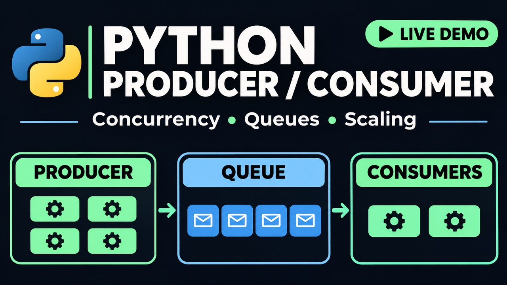

# Producer/consumer web link extractor

[](https://www.youtube.com/watch?v=RcMPKJ6Shp8)

**[Watch the 79-second demo on YouTube](https://www.youtube.com/watch?v=RcMPKJ6Shp8)** —
see concurrent fetching, oldest-entry trimming and a second consumer draining the queue.
The video description includes the full original task brief.

A small Python command-line program: one producer fetches HTML, a bounded
in-memory queue passes pages to one concurrent consumer, and the consumer extracts
hyperlinks. The CLI uses Python 3.10+ with no third-party dependencies. An optional
Flask dashboard visualises the same workers. CLI tested on Python 3.12 and 3.13;
dashboard tested on Python 3.13.

For diagrams and a complete explanation of both modes, see [the code walkthrough](WALKTHROUGH.md).

## Visual demo: one process, one command

On Windows, install Git and Python 3.13 first. Then clone the repository and set
up the optional UI in PowerShell:

```powershell
git clone https://github.com/timmayy54/producer-consumer-demo.git
cd producer-consumer-demo
py -3.13 -m venv .venv
.\.venv\Scripts\python.exe -m pip install -r requirements-ui.txt
```

The `.venv` directory is created locally and excluded from Git. Each person creates
their own environment; it is not supplied by cloning the repository. Setup is only
needed once per checkout, unless the environment or dependencies change.

From the repository directory, start the app with:

```powershell
.\.venv\Scripts\python.exe app.py
```

This uses the virtual environment directly, so activation is optional. On subsequent
runs, only this start command is needed.

Open http://127.0.0.1:5000 and choose **Basic demonstration** or **Advanced demonstration**.
Flask serves the dashboard and generated pages in one threaded process. Stop with
Ctrl+C; restart after Python changes and refresh the browser after UI changes.
This is a local development demo bound to loopback.

The **basic demo** fetches sequentially at up to 5 pages/second and parses at up to
4 pages/second. Its queue holds up to 100 pending records and blocks the producer
when full (backpressure). Expect about 25 seconds and a peak near 20 waiting pages.
Pacing includes actual fetch/parse time; timings depend on the machine and failures.

The UI polls actual worker/queue state approximately every 200 ms and shows results,
link/error counts and peak depth. Completion markers are excluded from page counts.
Refreshing does not restart a run; overlapping starts are rejected. Either button
starts a fresh batch after completion. Routine HTTP access logs are suppressed
when launched with `python app.py`; warnings and errors remain visible.

The basic UI reuses `extractor.py` through pacing wrappers and observable queue/list
subclasses. A lock protects display state. Match titles are demo metadata; hyperlinks
are the extractor output. The CLI remains unpaced and does not require Flask.

### Advanced demonstration

`advanced.py` reuses the core fetcher, parser, consumer and Page record:

| Setting | Behaviour |
|---|---|
| Four fetch workers | Minimum 1 second per fetch per worker: up to 4 pages/second combined |
| One initial consumer | Minimum 0.4 seconds per parse: up to 2.5 pages/second |
| Queue capacity | Ten pending pages; replace the oldest on arrival at capacity |
| Fifth cumulative drop | Automatically start Consumer 2 on the same queue |
| After intervention | Up to 5 pages/second consumed; trimming remains active |

Eviction and insertion are atomic. Producers do not wait for capacity, and
in-progress pages are never evicted. The second consumer represents a scripted
DevOps intervention, not an actual person or general autoscaler.

After scale-out, the backlog should shrink, though bursty arrivals can still cause
drops. Expect roughly 26–28 seconds; counts depend on scheduling. The UI identifies
workers, the intervention and dropped pages. At completion, **processed + dropped
= 100**. Errors are included in processed results, not counted as successful link
extraction. Static demo pages are not actually stale: dropping sacrifices completeness.

All fetch jobs finish before one completion marker per started consumer is added.
Markers use reserved control space and never evict pages; no new pages may be
enqueued after shutdown starts. Completion order need not match input order.

## Command-line use

```powershell
python extractor.py https://example.com
python extractor.py --file urls.txt --queue-size 100 --timeout 10
```

Input files contain one URL per line; empty lines are ignored. Positional URLs
and file entries can be combined. Output is one JSON object per input occurrence
on stdout, in input order, after processing completes. Redirect to save it:

```powershell
python extractor.py --file urls.txt > results.jsonl
```

Success: `{"url": "...", "links": ["/next", "#market"]}`.
Failure: `{"url": "...", "stage": "fetch", "error": "..."}` (or stage `parse`).
Exit codes: 0 means all pages processed successfully, 1 means one or more page
failures, and 2 means invalid command-line input. An empty HTML page succeeds
with an empty link list.

## Local pages for the CLI (optional)

Generate 100 repeatable fictional football pages, then serve them in terminal 1:

```powershell
python demo.py
python -m http.server 8000 --bind 127.0.0.1 --directory demo_site
```

In terminal 2, run `python extractor.py --file demo_site/urls.txt`.
The Flask demos do not need this separate server. Stop it with Ctrl+C.
The generator supports `--count` and `--port`; match the port in the server command.
Generated files are ignored by Git and can be regenerated. The generator overwrites
matching generated filenames; use the dedicated demo_site directory only.

Each page has a fictional match-winner market, over/under 2.5 prices, and three
anchors. The extractor reads anchors, not betting odds, and does not follow links.
Teams are familiar English clubs, not a current-season fixture list.

Match-winner prices form approximately a 104% book after rounding, with odds between
approximately 2.419355 and 3.0. Over/under prices range from 1.5 to 3.0 independently,
without a book-percentage target. The walkthrough explains the generation arithmetic.

## Core CLI flow

1. `main` reads URLs and settings, calls `run_pipeline`, then prints JSON results.
2. `run_pipeline` creates a `Queue(maxsize=...)` and starts two threads. Only the
   consumer changes the result list; main reads it after joining both threads.
3. `produce` calls `fetch_html` once per URL and queues a `Page` containing its URL
   and HTML, or an explicit fetch error. A full queue blocks the producer.
4. `consume` blocks on `get`, parses each page, and records a result or parse error.
5. The producer's `finally` block queues `None`. FIFO ordering means the consumer
   sees this marker after all preceding pages and exits. Temporary emptiness is
   never mistaken for completion. Thread joins wait for the workers to finish.

`extract_links` uses the standard-library HTML parser, not a regular expression.
It collects `a[href]` values in document order, preserving duplicate, empty,
relative, fragment and non-HTTP hrefs. HTML entities are decoded. It does not resolve
relative URLs, honour `base` tags or execute JavaScript. The parser tolerates many
malformed HTML documents, so broken markup does not necessarily cause an error.

Per-page exception handling isolates fetch/parser failures. Requests use a socket timeout (not a strict
whole-request deadline), follow normal urllib redirects, require an HTML content
type and cap each response at 2 MB. Declared encoding is used, with UTF-8 as the
fallback and replacement for invalid byte sequences.

## Tests

```powershell
.\.venv\Scripts\python.exe -m unittest -v
```

There are 19 tests: 14 core tests and 5 advanced-demo tests. They cover hyperlink
semantics, local HTTP/CLI behaviour, concurrent progress, failure isolation, oldest
eviction, exact fifth-drop scaling, shutdown and input accounting. Tests use local
HTTP and injected failures, not external website availability. Advanced tests are
skipped without Flask; the core tests still run with `python -m unittest -v`.
Coverage is targeted, not claimed exhaustive; no coverage percentage is measured.

## Scope and tradeoffs

- The CLI/basic demo fetch sequentially and apply backpressure. The advanced demo
  implements concurrent fetching and oldest-entry trimming with explicit dropped results.
- Input URLs and extracted results remain in memory. This is a finite-batch demo,
  not a fully streaming or durable system. There is no queue persistence, automatic
  acknowledgement, retry, dead-letter handling or recovery after process failure.
- The fetch pool limits active jobs to four but submits all 100 tasks. Full UI
  histories and snapshots are retained; queue capacity is not a whole-process memory bound.
- The advanced demo adds a second consumer with its own completion marker. More
  parsing threads do not guarantee greater CPU throughput; these delays model work.
- No crawling, browser automation, odds validation, scheduling or external broker.
- Unexpected worker/instrumentation failures are not comprehensively supervised;
  thread joins do not propagate worker exceptions. See the walkthrough for limitations.

## Development process

Built with AI assistance and human-directed design decisions. The code, tests and
[walkthrough](WALKTHROUGH.md) document the implementation and its tradeoffs.
