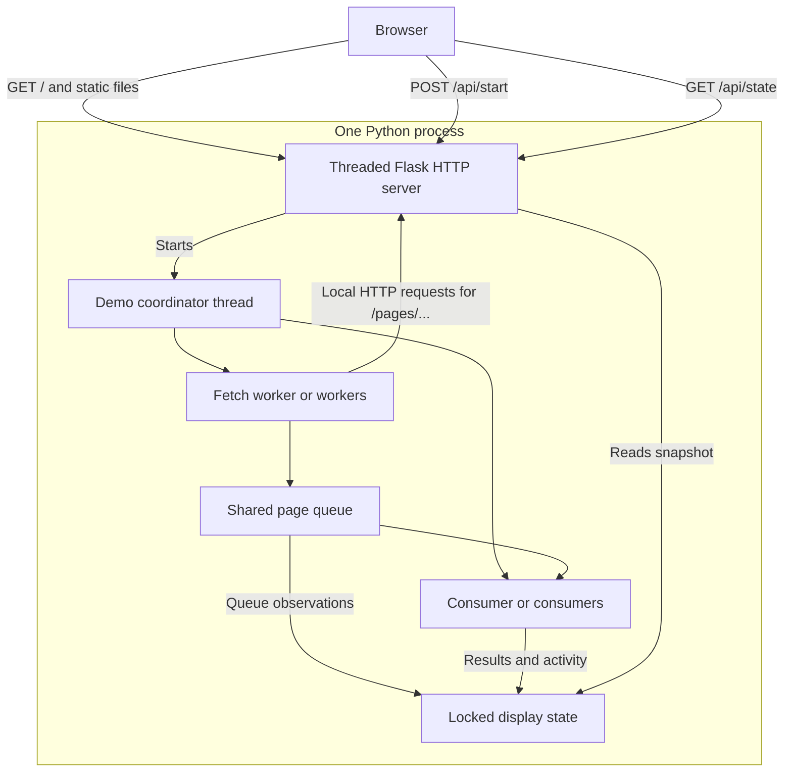
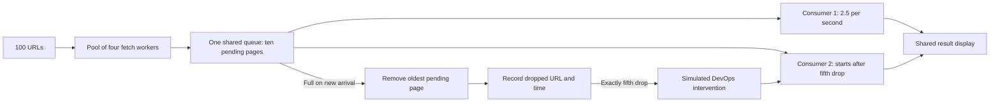

# Complete code walkthrough

Written 20 November 2026 against application commit **`5d27bc4`**. This describes the code as it exists, including the final pacing changes and quiet HTTP logging. Confidence is high for the code behaviour described; throughput and duration estimates are approximate, not guarantees.

The central idea is simple: **fetch HTML, transfer it through a queue, then extract hyperlinks in a separate worker.** The optional dashboard makes that work visible. The advanced demonstration adds concurrent fetching, oldest-page eviction and a second consumer.

This document follows execution order rather than reading every file from top to bottom. Code snippets are selected excerpts, not complete replacement implementations.

## Contents

1. [The three ways to run the application](#1-the-three-ways-to-run-the-application)
2. [File map and architecture](#2-file-map-and-architecture)
3. [The core extractor](#3-the-core-extractor)
4. [Sample HTML pages](#4-sample-html-pages)
5. [Flask and the shared display state](#5-flask-and-the-shared-display-state)
6. [How the basic dashboard observes the original code](#6-how-the-basic-dashboard-observes-the-original-code)
7. [The advanced demonstration](#7-the-advanced-demonstration)
8. [The browser UI](#8-the-browser-ui)
9. [Tests and what they establish](#9-tests-and-what-they-establish)
10. [Design boundaries and limitations](#10-design-boundaries-and-limitations)
11. [Walkthrough script and questions](#11-walkthrough-script-and-questions)

## 1. The three ways to run the application

| Behaviour | Command-line extractor | Basic UI demo | Advanced UI demo |
|---|---|---|---|
| Entry point | `python extractor.py ...` | `python app.py`, Basic button | `python app.py`, Advanced button |
| Input | Supplied URLs or URL file | 100 generated local pages | Same 100 generated local pages |
| Fetching | One URL at a time | One URL at a time | Four fetch workers |
| Artificial fetch duration | None | Minimum 0.20 seconds | Minimum 1.0 second per worker |
| Consumers | One | One | One initially; two after the fifth drop |
| Artificial parse duration | None | Minimum 0.25 seconds | Minimum 0.40 seconds per consumer |
| Queue policy | Backpressure; default capacity 100 | Backpressure; capacity 100 | Drop oldest; capacity 10 pending pages |
| Output | JSON lines after processing finishes | Live dashboard | Live dashboard, drops and intervention |
| Dependencies | Standard library only | Flask plus its dependencies | Same as basic UI |

### Run the dashboard

One terminal runs both the dashboard and the sample-page server:

```powershell
cd C:\code\producer-consumer-demo
.\.venv\Scripts\Activate.ps1
python app.py
```

Open **http://127.0.0.1:5000**. If activation is blocked, invoke the environment's interpreter directly:

```powershell
.\.venv\Scripts\python.exe app.py
```

Stop with Ctrl+C. After changing Python code, restart the server. After changing JavaScript or CSS, refresh the browser; Ctrl+F5 forces a fresh load.

For a fresh checkout, create a virtual environment and install the optional UI dependency first:

```powershell
py -3.13 -m venv .venv
.\.venv\Scripts\python.exe -m pip install -r requirements-ui.txt
```

The CLI can be used independently:

```powershell
python extractor.py https://example.com
python extractor.py --file urls.txt --queue-size 100 --timeout 10
```

## 2. File map and architecture

| File | Responsibility |
|---|---|
| `extractor.py` | Page record, HTTP fetching, hyperlink parsing, original producer/consumer, CLI |
| `demo.py` | Generate deterministic fictional football HTML pages |
| `app.py` | Flask routes, shared display state, basic demo, mode selection |
| `advanced.py` | Four-worker fetching, oldest-page eviction, second-consumer intervention |
| `templates/index.html` | Dashboard structure and named display elements |
| `static/app.js` | Start requests, polling, rendering counters/logs/results |
| `static/style.css` | Layout, colours, queue blocks, animations and responsive behaviour |
| `test_extractor.py` | Fourteen core and local HTTP/CLI tests |
| `test_advanced.py` | Five advanced-demo tests |
| `requirements-ui.txt` | Optional Flask dependency, pinned to 3.1.3 |
| `.gitignore` | Excludes generated pages, virtual environment, bytecode and local outputs |

### Basic pipeline


### One process serving both the UI and pages



**One process does not mean one thread.** The coordinator, fetchers, consumers and HTTP handlers can all make progress within the same process. No Docker container, broker or second page-server command is needed for the UI demos.

## 3. The core extractor

The UI additions have left `extractor.py` unchanged. Start by understanding this file; the other Python modules compose its functions.

### 3.1 Execution starts at the bottom

```python
if __name__ == "__main__":
    raise SystemExit(main())
```

When launched directly, Python loads the imports, defines the classes/functions, then calls `main()`. Defining a function does not execute its body.

When another module imports `extractor`, this condition is false. It can use `fetch_html()` or `consume()` without launching the CLI.

`main()` returns an exit code. `SystemExit` passes that code to the shell.

### 3.2 `main()` reads and validates input

`argparse` accepts positional URLs, an optional file, queue capacity and a timeout. `nargs="*"` means zero or more positional URLs. File lines are stripped, and blank lines are ignored. Positional URLs and file entries can be combined.

The file uses `utf-8-sig`, which also accommodates a UTF-8 byte-order mark. Invalid settings or unreadable input are reported through `parser.error()`.

The final call is:

```python
results = run_pipeline(
    urls, args.queue_size,
    fetch=lambda url: fetch_html(url, args.timeout),
)
```

The `lambda` is equivalent to defining a small function that receives a URL and calls `fetch_html` with the selected timeout. It adapts a two-argument operation to the one-argument callable expected by the producer.

Passing functions as arguments also makes testing straightforward: tests supply fake fetchers/parsers without changing the producer or consumer. This is dependency injection without a framework.

### 3.3 `Page` is the item transferred between workers

```python
@dataclass(frozen=True)
class Page:
    url: str
    html: str = ""
    error: str | None = None
```

The data class generates routine methods, including the constructor. `frozen=True` prevents ordinary field reassignment. Think of it as a small immutable record.

A success contains a URL and HTML. A failure contains a URL and an error string. The source URL always travels with the result so that links can be associated with the correct input.

`str | None` means either a string or `None`. Type annotations communicate intended types; they do not generally enforce them at runtime.

### 3.4 `run_pipeline()` starts the two workers

```python
pages: Queue = Queue(maxsize=queue_size)
results: list[dict] = []
producer = Thread(target=produce, args=(urls, pages, fetch), name="producer")
consumer = Thread(target=consume, args=(pages, results, parse), name="consumer")
consumer.start()
producer.start()
producer.join()
consumer.join()
return results
```

Both threads receive the same queue object, not separate copies. Only the consumer writes the ordinary results list; main reads it after the workers finish.

Constructing a `Thread` does not start it. `start()` starts its target function in that worker thread. `args` supplies its positional arguments.

`join()` means **wait for that thread to finish**. Calling `producer.join()` before `consumer.join()` does not make the workers sequential: both have already started. The consumer continues running while main waits for the producer.

### 3.5 `fetch_html()` does one HTTP operation

The function:

1. Rejects input schemes other than HTTP and HTTPS.
2. Builds a request with a descriptive User-Agent.
3. Opens the URL with a socket timeout.
4. Requires an HTML content type.
5. Reads at most 2,000,001 bytes and rejects a body exceeding 2,000,000 bytes.
6. Decodes the response using its declared charset, or UTF-8 as fallback.

Reading **limit plus one byte** distinguishes a response exactly at the limit from an oversized response without downloading an unlimited body.

```python
with urlopen(request, timeout=timeout) as response:
    ...
```

The context manager closes the response when the block exits, including on an exception. HTTP failures such as 404 are raised by `urllib`. Invalid byte sequences are replaced during decoding; an unknown declared encoding can still raise an error.

The timeout is a socket timeout, not a strict whole-operation deadline. The function follows ordinary `urllib` redirects and does not execute JavaScript.

### 3.6 `produce()` isolates fetch failures

```python
for url in urls:
    try:
        page = Page(url=url, html=fetch(url))
    except Exception as error:
        page = Page(url=url, error=f"{type(error).__name__}: {error}")
    pages.put(page)
```

Every attempted URL produces either HTML or a fetch-error record. A failed URL does not abort later URLs. `put()` happens after the exception handler so failures are visible rather than silently disappearing.

With the normal bounded queue, `put()` waits if the queue is full. That is **backpressure**: producers slow down to the consumer's sustainable rate instead of discarding queued work.

Capacity counts waiting items only. It excludes a page already taken by the consumer and a page held by a producer while waiting to enqueue.

### 3.7 An empty queue is not a finished producer

The producer may be downloading another page while the consumer waits. Therefore the consumer must not stop simply because `queue.empty()` is true.

The producer sends a special end marker in its outer `finally` block:

```python
finally:
    pages.put(None)
```

`None` is the **sentinel**, meaning no more pages will follow. It cannot be confused with a `Page` record.

```text
Page A → Page B → Page C → None
```

FIFO ordering means the single consumer handles the earlier items before receiving the marker. `finally` attempts this during normal exception unwinding as well as normal completion; it does not guarantee recovery after a killed process or a dead consumer.

### 3.8 `consume()` waits, processes and repeats

```python
while True:
    page = pages.get()
    if page is None:
        return
```

`get()` waits efficiently when no work is available. Once an item arrives, the consumer either:

| Item | Action |
|---|---|
| `None` | Return and finish the thread |
| `Page` with `error` | Append a fetch-error result and continue |
| `Page` with HTML | Call the supplied parser and append links or a parse-error result |

The parser call has its own `try/except`, so one parsing failure does not stop subsequent pages. The `else` attached to `try` runs only when that `try` block completes without an exception.

### 3.9 `extract_links()` and `LinkParser`

```python
parser = LinkParser()
parser.feed(html)
parser.close()
return parser.links
```

A fresh parser per page prevents links leaking between documents. The standard-library `HTMLParser` recognises tags and invokes our overridden `handle_starttag()` callback.

For `<a href="match-002.html">Next</a>`, the callback receives the tag name and its attributes. It checks for tag `a`, finds its `href`, appends that value and stops examining attributes for that anchor.

The output contract deliberately preserves:

- Document order and duplicate links.
- Relative URLs, fragments, empty href values and non-HTTP links such as `mailto:`.
- Decoded HTML entities, such as `&amp;` becoming `&`.

It ignores anchors with no href. It does not resolve relative URLs, honour base tags, follow extracted links, render JavaScript or parse betting prices.

Malformed HTML often remains parseable. Broken markup is not a dependable way to create a parser exception, so tests explicitly inject a parser failure.

### 3.10 Output and exit status

After both workers finish, main prints one JSON object per line:

```json
{"url": "http://example.test/page", "links": ["/next", "#market"]}
```

or:

```json
{"url": "http://example.test/page", "stage": "fetch", "error": "TimeoutError: ..."}
```

Exit codes are 0 for all page operations succeeding, 1 for any page failure, and 2 for invalid CLI input. Successful results are still printed when another input fails.

CLI/basic ordering follows input order because fetching is sequential and there is one FIFO consumer. The advanced mode does not preserve that ordering.

## 4. Sample HTML pages

`demo.py` creates 100 numbered files by default. `random.Random(42)` gives a repeatable sequence, so the examples do not change unpredictably between runs.

Each page contains a fictional match, match-winner prices, over/under 2.5 prices and three anchor links: the next match and two market fragments. The last page links back to the first. The extractor receives the 100-page URL list directly; it does not discover those pages by crawling the next-match links.

The match-winner implied probabilities sum to 1.04 before odds rounding:

```text
Decimal odds = 1 / implied probability
Book percentage = 100 × (1/home_odds + 1/draw_odds + 1/away_odds)
```

The generator distributes 0.04 above three base probabilities of 1/3. This keeps each match-winner price between approximately 2.419355 and 3.0. Prices are displayed with six decimals, introducing small rounding differences. Over/under prices are independent values between 1.5 and 3.0; that market has no specified book target.

These are synthetic examples, not current fixtures or live prices. Team names are display content. The parser's responsibility is still hyperlink extraction.

The generator also writes `urls.txt` using its supplied port, default 8000. **The UI does not use that file**: `app.py` builds its own `/pages/...` URLs using Flask's actual listening port. The file is intended for the separate CLI/static-server workflow.

## 5. Flask and the shared display state

### 5.1 Paths and server startup

```python
ROOT = Path(__file__).resolve().parent
SITE = ROOT / "demo_site"
app = Flask(__name__)
```

Paths are based on the Python file's directory, not the terminal's current directory. Flask uses the module location to find its templates and static assets.

The entry point starts Flask on `127.0.0.1:5000`, with `threaded=True`, `debug=False` and `use_reloader=False`. HTTP handlers can overlap, and there is no automatic reloader restarting the process during a run.

The producer's local HTTP request travels through the network stack back to this same server. HTTP remains real even though both ends live in one process.

The Werkzeug logger is set to `WARNING` when running `python app.py`. This suppresses routine successful request lines while keeping warning/error-level messages. It changes logging only, not polling or network behaviour. Launching through a different entry point, such as `flask run`, does not execute this `__main__` logging setup.

### 5.2 Routes

| Request | Handler | Response |
|---|---|---|
| `GET /` | `index()` | Rendered `templates/index.html` |
| `GET /static/...` | Flask's static handler | JavaScript or CSS |
| `GET /pages/<filename>` | `demo_page()` | Generated HTML from `demo_site` |
| `GET /api/state` | `state()` | JSON snapshot with `Cache-Control: no-store` |
| `POST /api/start` | `start()` | Start requested mode; HTTP 202, 409 or 400 |

The `@app.get(...)` and `@app.post(...)` decorators register functions as route handlers. Loading the dashboard does not start a demo. Its buttons send POST requests containing `{"mode":"basic"}` or `{"mode":"advanced"}`.

The start handler validates the mode, constructs a loopback base URL from `SERVER_PORT`, and delegates to `demo_run.start()`. It returns 202 when work is accepted, 409 when a demo is already running, and 400 for an unsupported mode. A missing mode defaults to basic.

### 5.3 `DemoRun` owns one run's display state

One global `DemoRun` object is shared by the server's threads. All browser tabs see the same run; there is no per-user session isolation.

| State field | Meaning |
|---|---|
| `produced` | Page records enqueued, including fetch-error records |
| `completed` | Results handled by consumers, including failed results |
| `errors` | Fetch/parse failures recorded in completed results |
| `links` | Total hyperlinks from successful results |
| `pending` | Filenames of page records currently waiting |
| `peak` | Highest observed pending-page count |
| `dropped` | Advanced-mode eviction records |
| `intervention` | Second-consumer trigger time and explanation |
| `fetch_workers`, `consumers` | Per-worker display statuses |
| `producer_done`, `consumer_done` | Phase completion flags |

`reset()` initialises the state. `start()` checks and changes the running state while holding a lock, preventing two simultaneous requests from starting two runs. It then starts a daemon coordinator thread and returns immediately to the HTTP handler.

`run()` generates the pages and dispatches to basic orchestration or `run_advanced()`. It records status and elapsed time. The UI daemon threads do not keep the process alive after server exit; stopping the server can abandon a run.

### 5.4 Locks, snapshots and elapsed time

Workers update the state while Flask request handlers read it. `with run.lock:` protects related changes so a snapshot does not see half of a multi-field update.

`snapshot()` makes a `copy.deepcopy()` under that lock. This copies nested lists/dictionaries, allowing Flask to serialize a stable value after releasing the lock. `time.monotonic()` supplies elapsed time without depending on wall-clock adjustments.

`RLock` is reentrant: the same thread may acquire it more than once. **The advanced mode now actually uses that property.** Queue insertion holds `run.lock`, then the fifth-drop callback calls `add_consumer()`, which acquires the same lock again. Replacing it blindly with an ordinary lock would deadlock this path.

The queue's internal lock and the display-state lock are different. Queue hooks take the queue lock first and then the state lock. Existing code avoids taking a queue operation while holding the state lock in the opposite order; preserving that order matters for avoiding deadlocks.

`log()` retains only the latest twelve entries per worker category. The full dropped-page/result lists remain available independently of that short console history.

## 6. How the basic dashboard observes the original code

### 6.1 Function wrappers add pacing

The basic coordinator passes `paced_fetch` into the original `produce()` and `paced_parse` into the original `consume()`.

```python
started = time.monotonic()
try:
    return fetch_html(url)
finally:
    time.sleep(max(0, 0.2 - (time.monotonic() - started)))
```

If fetching takes 0.03 seconds, the wrapper waits another 0.17 seconds. If it takes 0.35 seconds, no extra wait is added. The `finally` block runs before the pending return completes, so the producer cannot enqueue the returned HTML until the delay finishes.

The basic parser uses 0.25 seconds, approximately four pages/second. Pacing includes actual fetch/parse time rather than adding a fixed sleep on top. Other bookkeeping and scheduling still add overhead. Fetch-error records skip parsing, so they do not receive the parse delay.

### 6.2 `DisplayQueue` subclasses the real queue

`DisplayQueue` inherits capacity, blocking and synchronization from `Queue(maxsize=100)`. It observes the storage hooks `_put()` and `_get()`.

| Method | Role |
|---|---|
| `put()` | Public queue operation: waits for space, coordinates locking and notifications |
| `_put()` | Storage hook called inside the protected insertion operation |
| `get()` | Public queue operation: waits for an item and coordinates access |
| `_get()` | Storage hook called inside the protected removal operation |

The overridden hooks call `super()` to perform the actual operation, then update pending filenames, counts and activity. These observations occur while the queue's mutex is held, so insertions/removals and their displayed order stay coordinated.

The queue still holds `Page` records. `pending` is a display mirror, not another work queue. The `None` marker is passed through but excluded from the displayed page count.

### 6.3 `DisplayResults` observes `append()`

The original consumer still calls `results.append(result)`. The supplied object is a `DisplayResults`, a subclass of `list`, so its overridden method preserves the append and publishes counters/results to the UI.

It also reads the generated page's title for display. The basic path uses a small regular expression against the generator's known title format. This is separate from the real hyperlink parser, which uses `HTMLParser`.

The basic UI does not call `run_pipeline()`, because it needs its own observable queue/result objects. It repeats the small thread setup but reuses the original `produce()` and `consume()` functions.

## 7. The advanced demonstration

### 7.1 Final rates and expected behaviour

| Phase | Fetch capacity | Consumer capacity | Expected queue tendency |
|---|---:|---:|---|
| One consumer | Four workers × 1/s = 4/s | 1 × 2.5/s = 2.5/s | Grow towards capacity |
| Two consumers | Four workers × 1/s = 4/s | 2 × 2.5/s = 5/s | Backlog generally shrinks |
| Fetching finished | 0/s | Up to 5/s until empty | Drain and exit |

The rates are capacities under fast local operations, not precision guarantees. Four workers can finish in bursts, causing short-lived capacity pressure even when average consumer capacity is greater. Extra drops immediately after intervention are possible.

About 25 seconds are needed for four workers to attempt 100 pages at one second each, plus final processing and overhead. The README's roughly 26–28 seconds is an estimate. Earlier measurements at different settings are not evidence for these final timings.

### 7.2 Architecture



There are **two consumers sharing one queue**, not two queues. The intervention is automatic demo code simulating a person's decision. No external operator, infrastructure controller or second process is involved.

### 7.3 A continuously replenished fetch pool

```python
with ThreadPoolExecutor(max_workers=4, thread_name_prefix="fetch") as pool:
    futures = [pool.submit(fetch_and_enqueue, url) for url in urls]
    for future in futures:
        future.result()
```

`submit()` schedules a job and returns a `Future`, which represents its eventual completion or failure. At most four jobs execute concurrently. When a worker finishes, it takes another queued job; it does not wait for a batch of four to finish together.

Each job fetches a page, catches per-URL fetch failures, applies the one-second minimum duration, and enqueues the record itself.

**Waiting for futures in input order does not make fetching or queue insertion sequential.** The workers independently enqueue their results. The coordinator's loop is waiting for completion and surfacing unexpected job exceptions; it is not the location where results enter the page queue.

The executor context waits for submitted work when it exits. The job list contains all 100 inputs, which is proportionate here; the worker limit alone does not bound the number of pending submitted jobs for an arbitrary huge input.

### 7.4 Backpressure is deliberately replaced in this mode

Basic mode: a full queue makes a producer wait.

Advanced mode: a full queue makes a producer discard the oldest waiting page and insert the new one.

`DroppingQueue` therefore starts its base queue with:

```python
super().__init__(maxsize=0)
```

For `Queue`, zero means no built-in capacity wait. The subclass enforces its own ten-page limit atomically in `_put()`. It is not accidentally allowing an unlimited page backlog.

“No backpressure” here means no waiting for queue capacity. Workers can still briefly wait for a mutex while another thread changes the queue or display state.

### 7.5 One new arrival at capacity removes one oldest item

While the queue mutex is held, `_put()` acquires the display lock and checks `len(state["pending"])`.

```text
Before: [A B C D E F G H I J]  — ten waiting pages
New K arrives
Drop A, insert K
After:  [B C D E F G H I J K]  — still ten waiting pages
```

The page count can equal ten. Eviction occurs when another page arrives while ten already wait. It does not discard five pages as one batch: it discards one per overflowing arrival, and the fifth cumulative eviction triggers scaling.

`super()._get()` removes the oldest actual record without invoking the normal display-dequeue path, because dropping is not consumption. The code separately removes its display entry and records URL, filename, reason, time and consumer count at the drop.

The explicit `unfinished_tasks -= 1` balances the removed item's internal task count. This program does **not** use queue `join()`/`task_done()` for normal processing; it waits for threads. That adjustment does not turn the queue into an acknowledgement or retry system. Adding queue task-joining later would require balanced completion calls for every consumed item and marker too.

### 7.6 The fifth eviction starts Consumer 2 exactly once

```python
if len(state["dropped"]) == 5:
    self.on_fifth_drop()
```

The drop list grows monotonically during a run. Equality with five is reached once, so the callback is invoked once.

The callback is `add_consumer()`, a nested function closing over the consumer-thread list, shared queue, result list and run state. It creates a named thread, updates the consumer count, records the intervention, and starts it.

The first call to `add_consumer()` happens before fetching starts. That creates Consumer 1. The callback creates Consumer 2 during the fifth eviction.

The new thread may begin executing immediately, but its queue `get()` cannot complete until the current insertion releases the queue mutex. It does not interrupt the insertion halfway through.

The fifth drop's ledger entry reports the consumer count before the intervention; later drops report two consumers. Trimming remains enabled after scaling.

### 7.7 Both consumers reuse the original consumer function

Each consumer executes:

```python
consume(pages, results, paced_parse)
```

Its parser wrapper uses the final 0.4-second minimum duration. Queue `get()` removes an item atomically, so the two consumers receive different records. They do not both process the same queued item.

This is the competing-consumers pattern. FIFO describes the order of removal, not the order in which parallel consumers finish.

The source URL identifies each result even when pages finish out of input order. `AdvancedResults.append()` acquires the display lock before appending and updating counters, because unlike the basic demo there are two result writers.

The thread name identifies which consumer produced each result. The advanced queue's separate `TitleParser` obtains display titles from fetched HTML; it does not change hyperlink extraction.

### 7.8 Completion markers are never evicted

After the executor has finished all jobs, no producer can add another page or trigger another consumer. Only then does the coordinator send one marker per consumer actually started:

```python
for _ in consumers:
    pages.put(None)
for worker in consumers:
    worker.join()
```

If no fifth drop occurred, only Consumer 1 exists and only one marker is sent.

Inside the queue, marker insertion bypasses eviction and sets `closing=True`. Subsequent real-page insertion is rejected. Markers use control space beyond the ten-page data limit, so the internal queue can temporarily contain ten pages plus two markers while the UI correctly reports ten pending pages.

The markers follow all remaining pages. A consumer takes at most one marker because it exits immediately afterwards. Another consumer can still be processing its last page when the first exits; joining all consumers ensures that final processing finishes too.

### 7.9 Accounting is part of the demonstration

At normal completion:

```text
processed results + dropped records = input count
```

Processed results include failures; errors are a subset of processed results, not another category to add to the equation. Dropped pages are not claimed as successfully extracted.

While running, some pages are pending, being fetched or being processed, so the displayed accounted-for total can be below 100. A consumer's final progress bar may remain below 100% when pages were dropped; the combined accounting explains that outcome.

## 8. The browser UI

### 8.1 HTML establishes the display

`templates/index.html` defines the two buttons, three pipeline panels, intervention banner, progress bars, result cards area and expandable drop ledger. IDs such as `depth` and `consumer-workers` allow JavaScript to update specific elements.

Jinja's `url_for('static', filename=...)` builds the static asset URLs. The deferred script runs after the document has been parsed.

### 8.2 `startDemo(mode)` requests work

The buttons pass `basic` or `advanced` to `startDemo()`. It POSTs JSON to `/api/start`, checks the HTTP response, and resets local rendering counters after a successful start.

The backend remains the authority preventing overlapping runs. UI disabled buttons are a convenience, not the only protection.

### 8.3 `poll()` obtains live state

```javascript
const response = await fetch('/api/state', {cache:'no-store'});
render(await response.json());
setTimeout(poll, 200);
```

The actual function handles errors and schedules the next poll after the current request finishes. It does not start overlapping polls every 200 ms regardless of response time.

This is polling, not WebSockets. Approximately five updates per second are enough to display the deliberately paced workers. Polling continues while idle so a refreshed or second browser tab can follow the current run. Connection failures show a message and disable the start controls until a successful poll restores state.

### 8.4 `render(state)` updates the screen

The function sets rates, worker text, queue capacity, policy, progress and totals from the current mode/state. It draws ten or 100 slots and marks the first `pending.length` as filled. Slot tooltips contain the waiting filenames.

Logs and worker rows are rebuilt from the snapshot. Result and dropped-page cards are added incrementally using `displayedResults` and `displayedDrops`; new cards are prepended so the newest appears first. A shorter result list indicates a reset and clears the old display.

Strings are assigned through `textContent` or text nodes rather than inserted as raw HTML. Extracted hrefs are displayed as text, not executed or automatically visited.

The browser samples state, so it may skip very brief intermediate transitions. The queue count and drop ledger come from actual operations, not a separate animation simulation.

### 8.5 CSS provides the visual explanation

`style.css` lays out the three panels side by side on wide screens and stacks them on narrower screens. It styles queue slots, result cards, console logs and worker spinners. Reduced-motion preferences disable animation. CSS does not control fetching speed, queue policy or scaling; those behaviours belong to Python.

## 9. Tests and what they establish

Run all tests with the UI environment:

```powershell
.\.venv\Scripts\python.exe -m unittest -v
```

There are **19 tests: fourteen core tests and five advanced tests**. All passed on the reviewed application version. Advanced tests are skipped when optional Flask dependencies are absent.

| Area | Evidence |
|---|---|
| Link extraction | Ordered href values, duplicates, entities, fragments, missing/empty hrefs, non-HTTP hrefs |
| HTML tolerance | Empty document and unclosed markup |
| Basic shutdown | Empty input finishes; capacity-one queue preserves all inputs and duplicates |
| Concurrent basic progress | Producer cannot finish its second fake fetch until the consumer parses the first |
| Failure isolation | A fetch failure and parser failure do not prevent later success |
| Local HTTP | Real page and 404, non-HTML response, unsupported scheme, response-size limit |
| Timeout configuration | Mock confirms the selected timeout reaches `urlopen`; not a real slow-network timing test |
| CLI | Subprocess fetches 100 local pages and emits 100 results; partial failure exits with code 1 |
| Demo odds | All five prices in range and three-way book approximately 104% |
| Eviction | Oldest ten of twenty enqueued records are discarded in order; fifth-drop callback fires once |
| Marker protection | Markers do not evict ten queued pages; late page insertion is rejected |
| Advanced concurrency/accounting | Four fetch calls overlap, both consumers process work, all inputs are processed or dropped exactly once |
| Advanced failures | Fetch/parse failures isolated; a small run finishes with only one consumer |
| API validation | Unsupported mode returns HTTP 400 |

The advanced overlap test uses a `Barrier(4)`: the first four fetch calls wait for each other. A sequential implementation cannot pass that synchronization point normally. A lock protects its active-fetch counter.

Tests inject short or zero pacing intervals so that most testing does not take a full visual run. They verify coordination and outcomes, not the exact final wall-clock demo duration. Browser checks during development separately exercised the display; these are not an automated visual regression suite.

No coverage percentage is measured. Passing these tests is evidence for the behaviours they exercise, not proof that every possible failure has been handled.

## 10. Design boundaries and limitations

### Queue policies express different priorities

| Policy | Priority | Cost |
|---|---|---|
| Backpressure in CLI/basic | Preserve acquired work | Slows acquisition when consumers cannot keep up |
| Oldest eviction in advanced | Prefer newer pending work | Deliberately loses input pages |

Oldest eviction can suit replaceable snapshots or video frames. It is not automatically suitable for incremental updates, orders or events whose effects must all be applied. This demo's static pages are not genuinely stale; eviction illustrates the policy and makes loss explicit.

### Concurrency is not the same as CPU parallelism

Threads overlap network waits and the artificial sleeps. Two consumers therefore demonstrate increased capacity in this simulation. Two threads do not guarantee twice the throughput for CPU-heavy Python parsing on a conventional GIL-enabled interpreter. That would require measurement and potentially a different execution model.

### The whole application is not constant-memory

The page backlog is bounded, and HTTP bodies are size-limited. However, inputs, futures, display titles, completed results and dropped records remain in memory. Deep-copying and transmitting full history every poll is acceptable for 100 pages, not an indefinite feed.

The advanced title cache is keyed by URL, which suits the fixed unique demo URLs. Repeated URLs returning changing titles would need per-input identity if this display were generalized.

### Queue hooks are a deliberate coupling

Overriding `_put()`/`_get()` and adjusting internal task counts keeps the original extractor unchanged, but couples instrumentation to Queue's implementation conventions. The queue also consults the display `pending` mirror for its advanced capacity check. A reusable library could separate policy state from presentation and expose explicit events instead.

Some title parsing/file reading occurs while locks are held. Fine for the tiny generated pages, but not a scalable pattern to copy without reconsideration.

### Failure handling has a defined boundary

Expected page fetch and parse exceptions are isolated. Unexpected exceptions in an observation hook or consumer thread are not comprehensively supervised. A coordinator `try/except` does not automatically catch exceptions raised on another thread, and `Thread.join()` does not rethrow them.

An unexpected consumer failure could leave the basic producer blocked, or leave advanced pages unprocessed while a coordinator still reaches a completion status. The current tests do not inject arbitrary instrumentation crashes. The normal finish messages assume normal worker completion.

There is no durable storage, retry policy, dead-letter queue, automatic cancellation, restart recovery or guaranteed delivery after process failure. `task_done()` is not a broker acknowledgement; this program does not use it. Terminating the local server abandons in-memory work.

### Local demonstration scope

Flask's development server is bound to loopback. The app has one global run, no multi-user isolation and no production deployment design. The CLI accepts supplied URLs; the UI deliberately uses generated local pages. There is no recursive crawling, browser engine, odds extraction or external message broker.

## 11. Walkthrough script and questions

### A concise explanation of the whole application

> The core is a producer/consumer link extractor. A producer fetches HTML and queues a record containing the source URL and either HTML or an error. A separate consumer parses hyperlinks and records a result. An explicit completion marker prevents temporary queue emptiness from being mistaken for completion. The basic CLI waits for both threads and prints JSON.
>
> Flask adds a local dashboard and serves the sample pages from the same process. It reuses the core functions, wraps operations with visible pacing, and observes queue operations and result appends. The browser polls a locked state snapshot.
>
> The advanced demo uses four continuously replenished fetch workers. Its queue admits at most ten pending pages and replaces the oldest when full. The fifth drop triggers a simulated operational decision to start a second consumer on the same queue. At the final settings, one consumer is slower than the producer, while two have enough capacity to drain the backlog. Dropped work remains explicit in the final accounting.

### Questions to be ready to answer

| Question | Answer |
|---|---|
| Why use an in-memory queue? | The exercise runs in one process and does not require durable broker semantics. |
| Why not stop on an empty queue? | The producer may still be fetching; a marker establishes that no more pages will follow. |
| Why not wait for fixed batches of four? | Replenishing workers keeps available slots busy when request durations differ. |
| Does waiting for futures in input order serialize fetching? | No; workers execute and enqueue independently before the coordinator retrieves completion. |
| Why one queue for two consumers? | Atomic removal distributes different records to available workers without manual assignment. |
| Why keep the queue limit at ten after scaling? | Scaling changes processing capacity, not the selected freshness/loss policy. |
| Is the fifth drop one batch of five removals? | No; it is the fifth individual overflow eviction since the run started. |
| Can the second consumer make every later drop disappear? | Not guaranteed; bursty arrivals can still exceed available space briefly. |
| Why does the advanced consumer count finish below 100? | Some inputs were explicitly dropped; processed plus dropped accounts for all inputs. |
| Why is `RLock` used? | The fifth-drop path acquires the state lock and calls a function that acquires it again on the same thread. |
| Why two shutdown markers? | Each consumer removes one marker and exits; both must be able to stop. |
| Why can the queue internally exceed ten entries at shutdown? | Ten is the page limit; reserved completion markers do not evict pending work. |
| Are match prices part of extraction? | No. They are fixture content; extracted output is anchor href values. |
| Is the UI a simulated pipeline? | The HTTP calls, queue, parsing and drops are real; pacing and the intervention trigger are artificial demo choices. |
| What would need work for production? | Supervision, cancellation, resource limits beyond queue depth, persistence/retry semantics where required, monitoring and source-specific correctness. |

### Suggested reading order in the editor

1. `extractor.py`: `Page`, `run_pipeline`, `produce`, `consume`.
2. `extractor.py`: `fetch_html`, `LinkParser`, `extract_links`, `main`.
3. `app.py`: routes, `DemoRun.start`, `DemoRun.run`, `snapshot`.
4. `app.py`: basic pacing wrappers, `DisplayQueue`, `DisplayResults`.
5. `advanced.py`: `run_advanced`, then `DroppingQueue`, then `AdvancedResults`.
6. `static/app.js`: `startDemo`, `poll`, `render`.
7. Tests: first the basic concurrency test, then the advanced overlap/eviction/accounting tests.

Keep the four questions in view while reading: **who owns the work, where does it wait, what happens on failure, and how does every worker know when to stop?**
